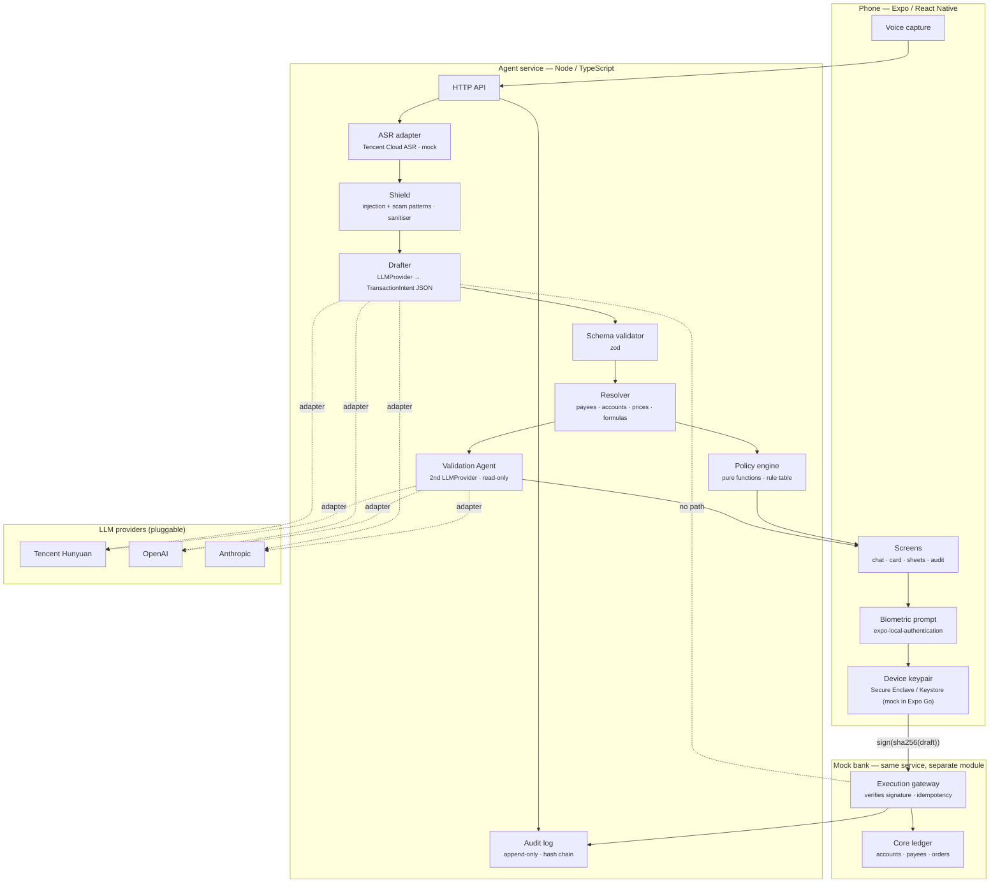

# Architecture

Zero-trust agentic architecture for SayPay. The one-sentence version: **the model writes a draft;
code decides; the human signs; the gateway only accepts signatures.**

## Components



## Trust boundaries and what crosses them

| Boundary | Crosses | Enforced by |
|---|---|---|
| User content → LLM | Transcript as **data** inside a fixed template; payee/account *names* only; system prompt isolated; delimiters escaped | Shield + prompt builder |
| LLM → service | JSON only; parsed with a strict schema; unknown keys rejected; symbolic formulas, no numbers for derived values | `zod` schema, retry-once-then-ask |
| Service → user | Card rendered from the **resolved** draft, never from model prose | UI reads `TransactionDraft` only |
| User → gateway | `draft` + `signature = sign(sha256(canonical(draft)))` | Device key; gateway verifies |
| Gateway → ledger | Only verified, non-replayed, idempotent drafts | Gateway middleware |

The drafting LLM has **no tool definitions**. There is no function the model can call. The
`LLMProvider` interface is `complete(prompt): Promise<string>` — text in, text out.

## Key types (shared `packages/shared`)

```ts
type Intent =
  | { kind: "transfer"; amount: Money | Formula; payeeRef: string; sourceRef?: string; reference?: string }
  | { kind: "bill_payment"; amount: Money | Formula; billerRef: string; sourceRef?: string }
  | { kind: "buy_equity"; amount: Money | Formula; assetRef: string; sourceRef?: string };

type Formula =
  | { op: "remaining"; account: string }          // balance after prior steps
  | { op: "half" | "all"; of: Formula }
  | { op: "percent"; pct: number; of: Formula };

interface TransactionDraft {
  id: string; version: number; transcriptId: string;
  steps: ResolvedStep[];                             // concrete Money, ids, prices
  status: "drafting" | "awaiting_clarification" | "frozen" | "ready" | "authorised" | "executed" | "failed" | "expired" | "cancelled";
  validation: { verdict: "ok" | "discrepancy" | "unavailable"; details?: Discrepancy[] };
  policy: { tier: "pin" | "biometric" | "biometric_oob"; decisions: PolicyDecision[]; hold?: Hold };
  hash: string;                                      // sha256 of canonical JSON of steps
}
```

Money is integer cents. Formulas are evaluated in `resolver.ts` with unit tests; the model never
sees a computed value.

## Policy engine (deterministic)

Rules are a table; each rule is a pure function `(draft, context) => PolicyDecision`. See
[`policy-rules.md`](policy-rules.md). The engine is exhaustively unit-tested first (constitution
Principle III).

## Validation Agent

Second `LLMProvider` call (can be a different vendor) with a read-only prompt:
*"Here is a transcript and a proposed transaction. List any field where they disagree."*
Output schema: `{ ok: boolean; discrepancies: {field, transcriptSays, draftShows}[] }`.
Any discrepancy, malformed output, or timeout → `frozen`. The validator cannot modify the draft.

## Authorisation and gateway

1. Card displays `hash` fingerprint (first/last 4 hex).
2. Biometric/PIN success unlocks the device private key (mocked in Expo Go with a stored key).
3. App signs `hash`; sends `{draftId, hash, signature, deviceId}`.
4. Gateway recomputes the hash from its own stored draft, verifies the signature against the
   registered device public key, checks tier satisfied, checks replay (nonce), checks idempotency,
   then executes steps in order.
5. Any mismatch → 403 with reason; audited.

## Audit log

Append-only array of `{seq, ts, stage, payload, prevHash, hash}`; `hash = sha256(prev + payload)`.
Served to the app for the "Why did the agent do this?" screen. Secrets never enter payloads.

## Tencent Cloud usage (for the "use of AI" criterion)

| Need | Tencent product | Fallback |
|---|---|---|
| Drafting / validation LLM | Hunyuan via OpenAI-compatible endpoint | OpenAI / Anthropic through the same adapter |
| Speech-to-text | Tencent Cloud ASR | on-device / typed input |
| Text-to-speech (read-aloud) | Tencent Cloud TTS | `expo-speech` |
| Build tooling | CodeBuddy (code), WorkBuddy (planning), Miora (visual assets) | — |

## Repository layout (planned)

```
apps/mobile        Expo app
apps/service       Node agent service + mock bank
packages/shared    types, schemas, policy rules (pure), audit hashing
design/            Figma exports, cover image, demo assets
docs/              this folder
specs/             Spec Kit artefacts
```
