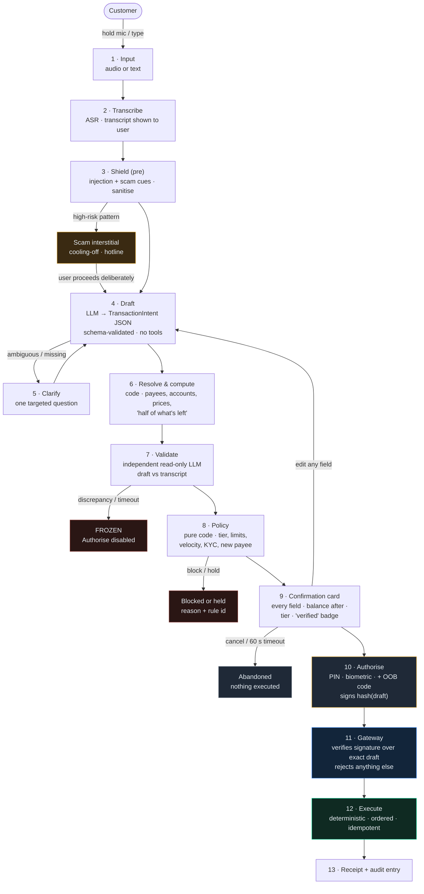
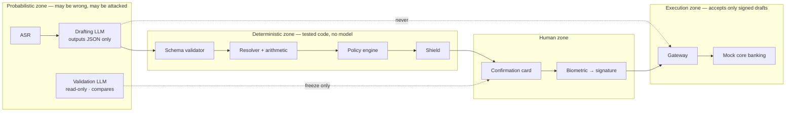
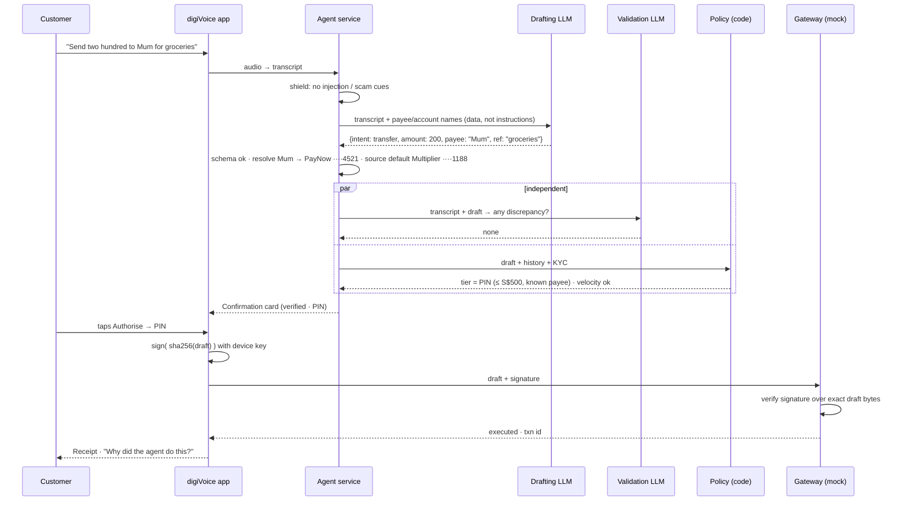
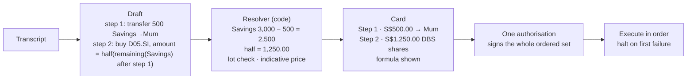

# Business Flow

How a spoken sentence becomes a signed, executed, audited bank transaction in digiVoice — and the
three places where it is deliberately stopped.

Source of truth for requirements: [`specs/001-conversational-transaction-agent/spec.md`](../specs/001-conversational-transaction-agent/spec.md).
Governing rules: [`.specify/memory/constitution.md`](../.specify/memory/constitution.md).

## 1. The one-line flow

```
Speak/Type → Transcribe → Draft (LLM) → Clarify → Validate (2nd LLM, read-only) → Policy (code)
→ Shield (code) → Confirm card → Sign (biometric) → Gateway verifies signature → Execute → Audit
```

Three stop points, none of which the language model can skip:

| Stop | Who decides | What the user sees |
|---|---|---|
| **Freeze** | Validation Agent finds a draft/transcript mismatch | "I may have misunderstood: you said *two hundred*, the draft shows S$2,000.00" — Authorise disabled |
| **Hold / Block** | Policy Engine (limits, velocity, KYC, new payee) | Plain reason, the rule that fired, what to do next |
| **Scam interstitial** | Shield (injection + scam patterns) | Warning, cooling-off timer, "Call DBS scam hotline" |

## 2. End-to-end flow



Every box from 1 to 13 appends to the audit log (see §5).

## 3. Trust boundaries



The dotted line labelled **never** is the whole product. The drafting model has no tool, no
function, and no network path to the gateway. Even a perfect prompt injection can only produce a
different *draft*, which still has to survive validation, policy, shield, the card, and a biometric
signature bound to its exact bytes.

## 4. Sequence — the happy path



## 5. What gets audited

Each interaction produces a hash-chained list of entries. The in-app audit view renders them in
order; a broken chain is shown as a red indicator.

| # | Stage | Recorded |
|---|---|---|
| 1 | Input | audio reference, duration, language |
| 2 | Transcript | text, ASR confidence |
| 3 | Shield | patterns matched, tier, user override (if any) |
| 4 | Draft vN | full JSON, LLM provider + model, prompt hash, output hash |
| 5 | Clarification | question asked, answer given |
| 6 | Resolution | payee/account/asset ids, formulas and inputs |
| 7 | Validation | verdict, fields compared, discrepancy detail |
| 8 | Policy | each rule id, inputs, outcome, required tier |
| 9 | Card shown | draft hash displayed, timestamp |
| 10 | Authorisation | tier, method, signature fingerprint, draft hash signed |
| 11 | Gateway | accept/reject, reason |
| 12 | Execution | step results, transaction ids |
| 13 | Terminal state | executed / cancelled / expired / frozen / blocked |

Never recorded: PINs, biometric templates, raw credentials.

## 6. Multi-intent and dependent amounts

"Transfer five hundred from my savings to Mum, then buy DBS shares with half of what's left."



The model emits a *symbolic* formula (`half(remaining(savings))`), never a number it computed
itself. Arithmetic is code.

## 7. The three refusal flows (demo beats)

| Flow | Trigger in demo | Expected screen |
|---|---|---|
| Clarify | "Send fifty to John" (two Johns) | Chip chooser: John Tan ····4521 / John Lim ····8892 |
| Freeze | Test hook corrupts amount 200 → 2000 | Red freeze banner, both values side-by-side, Authorise disabled |
| Scam | "Police asked me to move ten thousand to a safe account 123-45678-9 urgently" | Amber interstitial, 30 s cooling-off, hotline button, "new payee + large amount + authority cue" explained |
