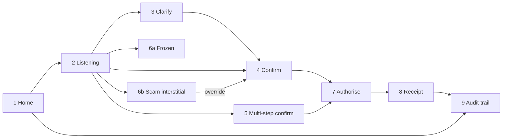

# UX Screens

Screen-by-screen specification for the SayPay mobile app. This is the blueprint for the Figma
mockups in `design/` and for the Expo implementation. Device frame: iPhone 15 (393 × 852 pt).

## Design principles

1. **The card is the product.** Everything funnels into one native confirmation card that shows
   exactly what will happen. It is never a chat bubble; it is a system overlay the agent cannot
   restyle or hide.
2. **Say it back before you do it.** Transcript is always visible; derived values show their
   formula; the card can be read aloud.
3. **Three colours mean three things.** Green = verified/ready. Amber = caution/cooling-off.
   Red = frozen/blocked. Never reused decoratively.
4. **One question at a time.** Clarifications are single-choice chips, never free text when a
   choice exists.
5. **Big by default.** 17 pt body, 44 pt touch targets, high contrast; the Mandarin/Malay/Tamil
   variants are the same layout.

## Visual language

| Token | Value | Use |
|---|---|---|
| `bg` | #0B0F14 | App background (dark, bank-grade) |
| `surface` | #121821 | Cards, sheets |
| `surface-2` | #1A2230 | Nested rows |
| `text` | #E6EDF3 | Primary text |
| `text-muted` | #8B949E | Labels, metadata |
| `brand` | #E4002B | DBS red — primary CTA, mic |
| `ok` | #00D492 | Verified, executed |
| `warn` | #D29922 | Scam interstitial, cooling-off, step-up |
| `danger` | #F85149 | Frozen, blocked, chain break |
| `info` | #388BFD | Audit, signature, gateway |
| Radius | 16 (cards) / 12 (rows) / 999 (chips) | |
| Type | SF Pro / Inter · 28 semibold titles · 17 body · 13 meta | |

## Screen map

## Screens

### 1 · Home
- **Purpose** orient, show balances, invite voice.
- **Layout** greeting + language chip (EN/中文/BM/தமிழ்) · account carousel (Multiplier ····1188
  S$8,420.15 · Savings ····2201 S$3,000.00 · Invest) · "Recent" list with status pills
  (Executed / Cancelled / Frozen) · bottom: large red mic button "Hold to speak" + text field
  "or type a request".
- **States** empty recent; KYC-incomplete banner (amber) with "Complete verification".

### 2 · Listening / Transcript
- **Purpose** show the system is hearing, show what it heard.
- **Layout** waveform · live transcript in large text · language detected · "Release to send"
  hint; after release: transcript locked with "Edit" link, shimmer "Understanding…".
- **States** unintelligible → "I didn't catch that — try again" (never drafts).

### 3 · Clarify
- **Purpose** resolve exactly one ambiguity.
- **Layout** transcript (muted) at top · agent question in one sentence · 2–4 choice chips with
  distinguishing detail ("John Tan · PayNow ····4521 · last paid 12 Sep") · "None of these" ·
  progress dots when more than one clarification is pending.
- **States** amount confirmation variant: "Fifty dollars — S$50.00?" with [Yes] [No, S$500] [Type it].

### 4 · Confirm (single step)
- **Purpose** the deterministic card.
- **Layout**
  - Header: "Confirm transfer" · verified badge (green shield "Verified against what you said").
  - Field rows (each tappable → edit): Amount **S$200.00** · To **Mum** PayNow ····4521 ·
    From **Multiplier ····1188** · Reference **"groceries"** (quoted, inert) · Balance after
    **S$8,220.15**.
  - Tier row: "Requires **PIN**" with info icon → why (rule id POL-TIER-01).
  - Primary button **Authorise with PIN** (red) · secondary **Cancel** · countdown "Expires in 0:58".
  - Read-aloud icon (speaker) top-right.
- **States** edited field → badge turns grey "Re-verifying…" then green; tier may change.

### 5 · Confirm (multi-step)
- Same chrome as 4, with a numbered step list:
  - **Step 1** Transfer S$500.00 · Savings ····2201 → Mum
  - **Step 2** Buy DBS (D05.SI) · **S$1,250.00** · formula chip "half of remaining S$2,500.00" ·
    "≈ 28 shares @ S$44.12 indicative"
  - Footer: "Executed in order. If Step 1 fails, Step 2 will not run."
  - Tier: **Biometric** (investment order).
- **States** unsupported step shown greyed with "Not supported — will be skipped" and a required
  acknowledgement checkbox.

### 6a · Frozen (validation discrepancy)
- **Purpose** stop and explain.
- **Layout** red banner "Frozen — I may have misunderstood" · comparison rows: *You said* "two
  hundred" / *Draft shows* S$2,000.00 (amount row highlighted) · buttons **Say it again**,
  **Fix the amount**, **Cancel** · Authorise absent entirely.
- **States** validator timeout variant: "Couldn't verify this draft — nothing was sent."

### 6b · Scam interstitial
- **Purpose** break the scammer's momentum.
- **Layout** amber full-screen · title "Pause. This looks like a scam pattern." · bullet reasons
  ("Mentions police or authority", "New payee you've never paid", "Large amount with urgency") ·
  **Call DBS scam hotline (1800 339 6963)** · 30 s cooling-off ring on the "I understand, continue"
  button (disabled until 0) · "What scammers say" link · Cancel.
- **States** injection-only variant (no scam cues): slimmer banner "Ignored instruction-like
  text in your request".

### 7 · Authorise
- **Purpose** bind the human to the exact draft.
- **Layout** bottom sheet · draft hash fingerprint "a3f9·…·71c2" with "This code identifies
  exactly what you're approving" · Face ID glyph → success tick · for OOB tier: 6-digit code
  entry "Code sent to ····8821" · "Signed on this device" line after success.
- **States** biometric unavailable → PIN + OOB; failure → retry / cancel; never auto-proceeds.

### 8 · Receipt
- **Purpose** close the loop honestly.
- **Layout** green tick · "Sent S$200.00 to Mum" · transaction id · time · balance now ·
  **Why did the agent do this?** (link to 9) · Done.
- **States** multi-step: per-step results; partial failure clearly marked.

### 9 · Audit trail — "Why did the agent do this?"
- **Purpose** non-repudiation, explainability.
- **Layout** vertical timeline, each node: stage name, timestamp, one-line summary, expandable
  JSON · chain-integrity pill (green "Chain intact" / red "Chain broken") · provider/model line
  for LLM stages · rule ids for policy · signature fingerprint for authorisation · export icon.
- **States** cancelled/frozen/blocked interactions show terminal reason at the bottom.

## Accessibility
- All text ≥ 17 pt body; dynamic type honoured.
- Every actionable element ≥ 44 pt and labelled for screen readers.
- Colour is never the only signal (icons + words on every status).
- Read-aloud of the confirmation card available in all four languages.

## Copy rules
- Plain words: "Send", "Pay", "Buy". No "execute", "initiate", "payload".
- Amounts always as `S$1,250.00`; payees always with a masked identifier.
- Refusals always say what happened, why, and what to do next — in that order.
